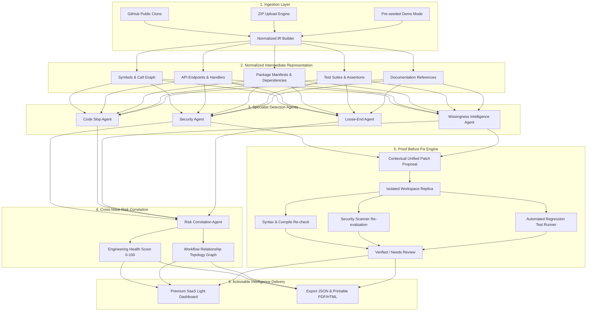

# CODE SENTINEL — Architecture & Engineering Specification

## 1. System Overview

**CODE SENTINEL** is an architecture-agnostic autonomous engineering auditor designed to uncover hidden vulnerabilities, architecture degradation, missing implementation safeguards, and correlated operational risks in software repositories.

Tagline: *"Find what is wrong. Discover what is missing. Prove the fix works."*

## 2. The Core Innovation: Missingness Intelligence

Traditional scanners exclusively detect code patterns that already exist (such as regex matches for known patterns). Code Sentinel's **Missingness Intelligence** analyzes what **should exist according to software engineering contracts but does not exist**:
- **Missing Authentication & Authorization**: Detects mutating endpoints (`POST`, `PUT`, `DELETE`) operating without token validation or permission dependencies.
- **Missing Input Validation**: Identifies unconstrained, unvalidated parameters reaching critical business boundaries.
- **Missing Error Handling**: Flags naked exceptions and unhandled database queries that result in uncommitted transactions and stack trace leakage.
- **Missing Automated Tests**: Discovers endpoints and workflows with zero test coverage in the test directory.
- **Documentation vs Implementation Mismatches**: Matches OpenAPI/README specifications against actual source code to expose promised features that were never implemented.

## 3. Engineering Health Score Algorithm

The Engineering Health Score is calculated deterministically on a scale of `0.0` to `100.0`. It uses documented, configurable severity penalties:

$$\text{Health Score} = \max\left(0, 100 - \sum \text{Deductions}\right)$$

### Penalty Schedule
| Category | Critical | High | Medium | Low |
| :--- | :--- | :--- | :--- | :--- |
| **Security Finding** | -18.0 pts | -10.0 pts | -4.0 pts | -1.0 pt |
| **Missingness Gap** | -14.0 pts | -8.0 pts | -3.0 pts | -1.0 pt |
| **Loose End / Debt** | -6.0 pts | -3.0 pts | -1.0 pt | 0 pts |
| **Code Slop** | - | - | - | -1.5 pts |

Grade Thresholds:
- **Grade A (Healthy Posture)**: 80.0 – 100.0
- **Grade B (Elevated Risk)**: 60.0 – 79.9
- **Grade C (Significant Fragility)**: 40.0 – 59.9
- **Grade F (Critical Exposure)**: < 40.0

## 4. Isolated Sandbox Verification ("Proof Before Fix")

Code Sentinel guarantees that fixes are never applied speculatively:
1. Clones the repository into an ephemeral workspace directory (`data/sandbox/{id}`).
2. Applies the proposed unified diff safely.
3. Executes syntax & AST compilation validation (`python -m py_compile`).
4. Re-runs the Security & Missingness scanners against the patched sandbox to prove the finding is resolved.
5. Executes the regression test suite (`pytest`) in the sandbox within strict timeouts (30s).
6. Transitions status to `verified` only when all criteria pass.
7. Automatically destroys the temporary sandbox workspace.
